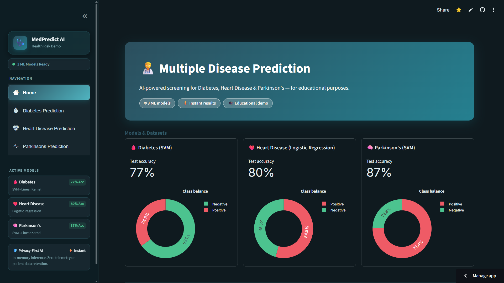
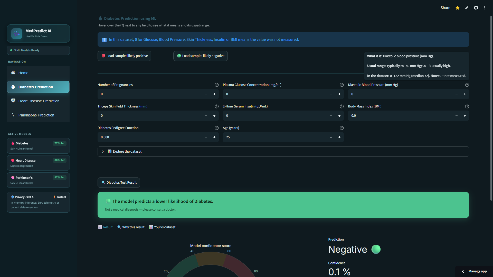
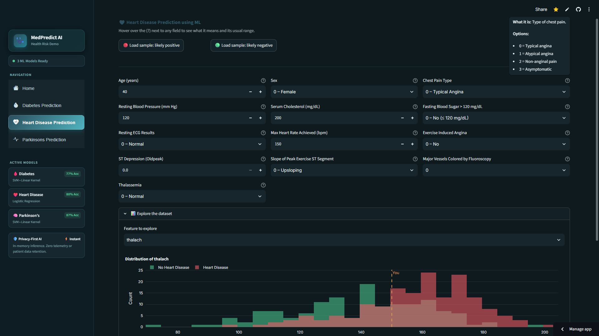
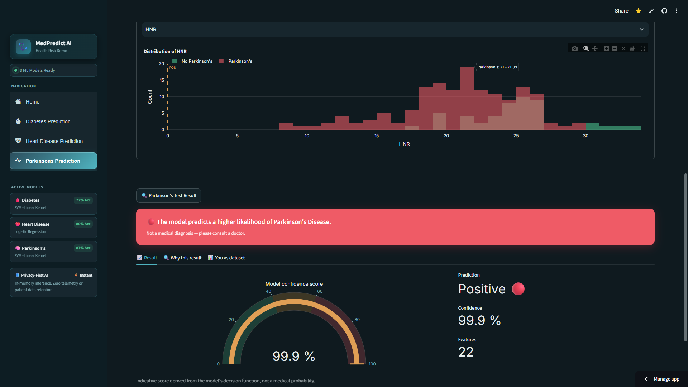
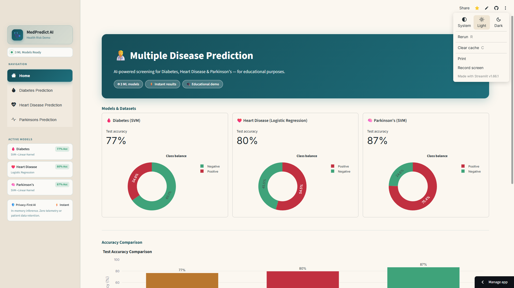
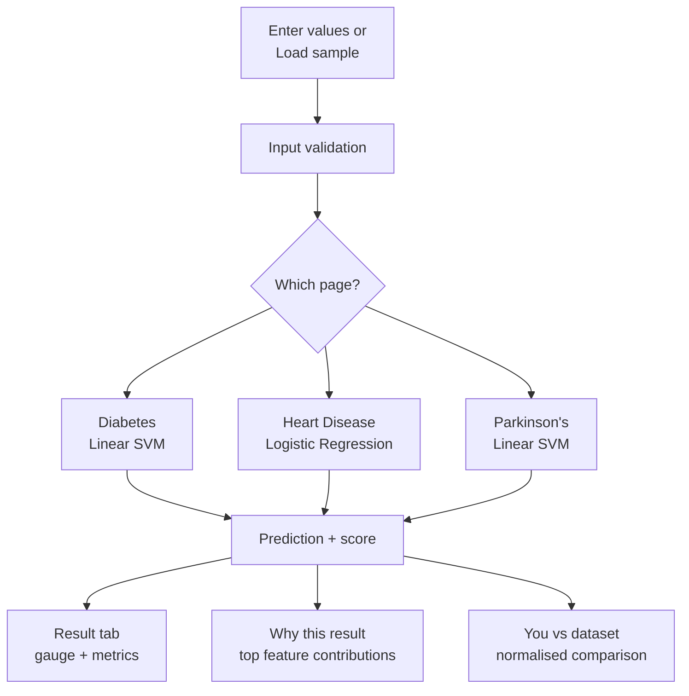

# Multiple Disease Prediction

**Predict diabetes, heart disease and Parkinson's from clinical inputs — with one-click demos, explainable charts and a light / dark / system theme.**

A machine-learning web app built for **Hack 5.0** at K.R. Mangalam University. Three scikit-learn models sit behind a Streamlit interface that lets anyone load a sample patient, run a prediction, and see *why* the model answered the way it did — not just a yes/no.

> Live demo → **[https://multiple-disease-prediction-app-by-ram0kr0singh.streamlit.app/](https://multiple-disease-prediction-app-by-ram0kr0singh.streamlit.app/)**
> *(free hosting sleeps when idle — click "wake up" and give it ~30 seconds)*

> **Educational demo. Not a medical diagnosis or a medical device.** Predictions come from small public datasets and must never replace advice from a qualified doctor.

---

## Quick Links

- [Live Demo](https://YOUR-APP-NAME.streamlit.app)
- [Screenshots](#screenshots)
- [How It Works](#how-it-works)
- [Features](#features)
- [Models and Results](#models-and-results)
- [Tech Stack](#tech-stack)
- [Getting Started](#getting-started)
- [Deployment](#deployment-streamlit-community-cloud)
- [Limitations](#limitations)
- [Team](#team)

---

## Screenshots

> Run the app locally, capture these pages, and save the images into `docs/screenshots/` using the exact filenames below — they render automatically once added.

| Page | Screenshot |
|---|---|
| Home — overview, model cards and accuracy chart |  |
| Diabetes — sample loaded, result and gauge |  |
| Heart Disease — "Why this result" chart |  |
| Parkinson's — voice-feature inputs with tooltips |  |
| Light theme — same app in light mode |  |

---

## How It Works

The user enters (or loads) a set of clinical values. The app passes them to a pre-trained model, then explains the answer with charts built from the same model and its training data.



**Reading the score.** The heart model (logistic regression) outputs a true probability. The diabetes and Parkinson's models are SVMs, which do not output probabilities, so the app shows a *model confidence score* — a sigmoid of the SVM's decision value. It is an indicator, not a medical probability, and the interface says so.

**Explaining the result.** Both model types are linear, so each feature's push on the answer is measured exactly:

```
contribution = model coefficient × (your value − dataset average)
```

Bars pointing toward "positive" show which of your values moved the model toward a positive result, compared with the average person in the training data.

---

## Features

**Home** — project overview, one card per model (type, test accuracy, class-balance donut), an accuracy comparison chart and a three-step "how it works" guide.

**One-click demo samples** — every prediction page has *Load sample: likely positive* and *Load sample: likely negative* buttons, filled with real rows from the datasets, so a first-time visitor sees a result in seconds.

**Guided inputs** — number fields and dropdowns with sensible ranges, and a hover tooltip (?) on every field explaining what it measures, its usual range and its range in the training data. Invalid or empty input shows a friendly message instead of crashing.

**Result tabs** — after *Test Result*: a result banner, then three tabs:
- **Result** — gauge (0–100) with prediction and score metrics
- **Why this result** — top features pushing the prediction up or down
- **You vs dataset** — your values against the average healthy and average positive case

**Dataset explorer** — a histogram of any feature split by class, with a live marker showing where your current input falls.

**Light, Dark and System themes** — switch from the app's top-right menu; the sidebar, cards and all charts re-style without a page reload (a small custom component reports the active theme back to Python).

**Dataset note on diabetes data** — in this dataset a value of 0 for Glucose, Blood Pressure, Skin Thickness, Insulin or BMI means "not measured". The app tells the user so.

---

## Models and Results

| Disease | Algorithm | Training rows | Features | Test accuracy |
|---|---|---|---|---|
| Diabetes | Linear SVM (`SVC(kernel="linear")`) | 768 | 8 | **77.3%** |
| Heart disease | Logistic Regression | 303 | 13 | **80.3%** |
| Parkinson's | Linear SVM (`SVC(kernel="linear")`) | 195 | 22 | **87.2%** |

Each model was trained on an 80 / 20 train–test split with `random_state=2` (stratified for diabetes and heart). Datasets are based on well-known public sources: the Pima Indians Diabetes dataset, the Cleveland heart disease dataset (UCI), and the Oxford Parkinson's Disease Detection voice dataset (UCI). Original Colab training notebooks are in `notebooks/`; `train_models.py` reproduces the same training locally.

> Accuracy is measured on a single small held-out split, so treat the figures as indicative, not as a clinical performance claim.

---

## Tech Stack

| Layer | Technology |
|---|---|
| Language | Python 3.13 |
| Web framework | Streamlit |
| Machine learning | scikit-learn (SVM, Logistic Regression) |
| Data | pandas, NumPy |
| Charts | Plotly |
| Navigation | streamlit-option-menu |
| Theme sync | Custom Streamlit component (HTML / JS) |
| Model storage | Pickled estimators (`.sav`) |
| Hosting | Streamlit Community Cloud |

---

## Project Structure

```
.
├── app.py                 # Streamlit app: pages, charts, theming
├── train_models.py        # Retrains the 3 models -> saved_models/
├── requirements.txt       # Pinned dependencies
├── README.md
├── .streamlit/
│   └── config.toml        # Light and dark theme definitions
├── theme_sync/
│   └── index.html         # Custom component: reports active theme to Python
├── saved_models/          # diabetes, heart_disease, parkinsons (.sav)
├── dataset/               # diabetes.csv, heart.csv, parkinsons.csv
├── notebooks/             # Original Colab training notebooks
├── scripts/               # verify_samples.py, verify_help.py, verify_theme.py
└── docs/
    ├── RUN_AND_DEPLOY.md  # Run and deployment guide
    └── screenshots/       # README images
```

---

## Getting Started

**Prerequisites:** Python 3.11 – 3.13 and Git.

```bash
# 1. Clone
git clone https://github.com/Ram0kr0singh/multiple-disease-prediction-app.git
cd multiple-disease-prediction-app

# 2. Create and activate a virtual environment
python -m venv venv
# Windows (PowerShell):  .\venv\Scripts\Activate.ps1
# macOS / Linux:         source venv/bin/activate

# 3. Install dependencies
pip install -r requirements.txt

# 4. Run
streamlit run app.py
# -> http://localhost:8501
```

On Windows, if another Python is installed, start the app through the virtual environment to be safe:

```powershell
.\venv\Scripts\python.exe -m streamlit run app.py
```

**Retrain the models** (optional — useful if you see a scikit-learn version warning):

```bash
python train_models.py
```

---

## Testing

Three verification scripts check the project end to end:

```bash
python scripts/verify_samples.py   # syntax, dependencies, dataset shapes, sample predictions, scores, contributions
python scripts/verify_help.py      # app setup, datasets, UI structure and tooltip coverage
python scripts/verify_theme.py     # theme helpers, figure styling, theme config
```

The six built-in samples (positive and negative for each disease) are expected to produce the same predictions every run.

---

## Deployment (Streamlit Community Cloud)

| Setting | Value |
|---|---|
| Repository | `Ram0kr0singh/multiple-disease-prediction-app` |
| Branch | `main` |
| Main file path | `app.py` |
| Python version | `3.13` |
| Secrets | none required |

Every push to `main` redeploys automatically. The `theme_sync/` folder must stay next to `app.py` — the app loads it as a component. See [`docs/RUN_AND_DEPLOY.md`](docs/RUN_AND_DEPLOY.md) for alternatives such as Hugging Face Spaces and Render.

---

## Security and Privacy Notes

- The app needs no API keys or secrets.
- Values entered by the user are processed in memory to produce a prediction; the app code does not store or log them.
- Models are loaded from the repository's own `saved_models/` folder. Only load pickle files you trust.

---

## Limitations

- **Not a diagnostic tool.** The models are trained on small, public, research datasets and have not been clinically validated.
- Accuracy comes from one train–test split; no cross-validation or external test set was used.
- The diabetes and Parkinson's scores are SVM-derived confidence values, not calibrated probabilities.
- Input features are used as provided; no feature scaling is applied, in keeping with the original notebooks.
- The training data is limited in size and population, so results may not generalise to other groups.
- Similarity to a dataset pattern is a signal, not proof of disease.

---

## Team

| Contributor | GitHub |
|---|---|
| Ram Kumar Singh | [@Ram0kr0singh](https://github.com/Ram0kr0singh) |
| Harsh Singh | [@Harsh0012-ux](https://github.com/Harsh0012-ux) |

Built by a two-person team.

---

## Acknowledgments

- **Hack 5.0**, K.R. Mangalam University, Sohna (Gurugram) — School of Engineering & Technology.
- Public datasets: Pima Indians Diabetes, UCI Heart Disease (Cleveland), UCI Oxford Parkinson's Disease Detection.
- Built with Streamlit, scikit-learn and Plotly.
